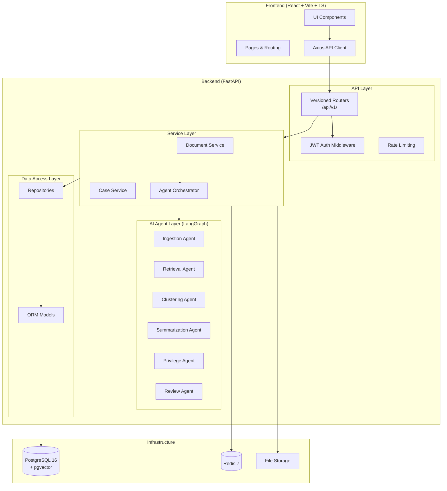

# Architecture — Agentic AI E-Discovery & Legal Review

## System Architecture

## Processing Pipeline

## Layered Architecture

| Layer | Responsibility | Example |
|-------|---------------|---------|
| **Router** | HTTP concerns, validation, response formatting | `api/v1/documents.py` |
| **Service** | Business logic, orchestration | `services/document_service.py` |
| **Repository** | Database access, queries | `repositories/document_repository.py` |
| **Model** | Data structure, ORM mapping | `models/document.py` |
| **Schema** | Request/response serialization | `schemas/document.py` |

## Technology Decisions

| Decision | Choice | Rationale |
|----------|--------|-----------|
| Async ORM | SQLAlchemy 2.0 async | Native asyncpg support, Alembic migrations |
| Auth | python-jose JWT | Provider-agnostic, works with Firebase/Supabase/local |
| Embeddings | pgvector | Integrated with PostgreSQL, IVFFlat indexing |
| Agent framework | LangGraph | State machine for complex agent workflows |
| Frontend state | React hooks + Axios | Simple, no global state needed yet |
| Styling | Tailwind CSS v4 | CSS-native config, Vite plugin, no JS runtime |
